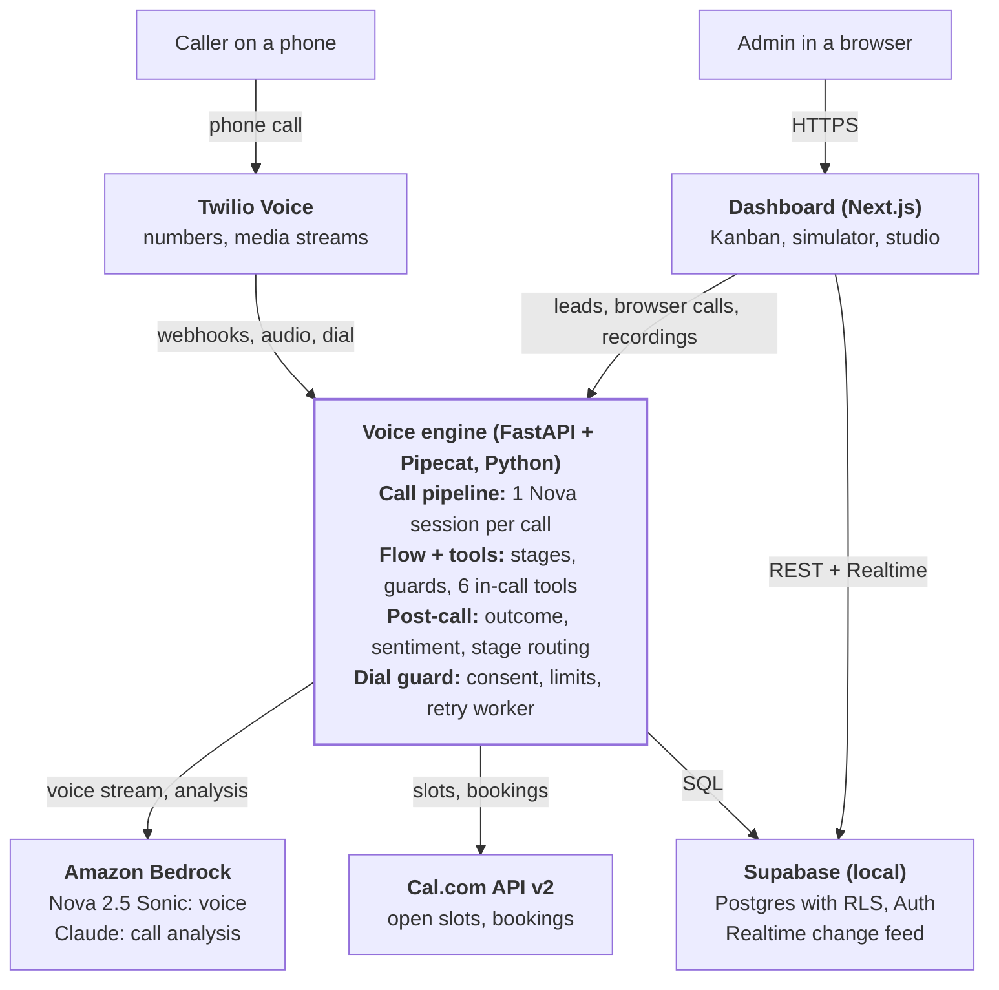
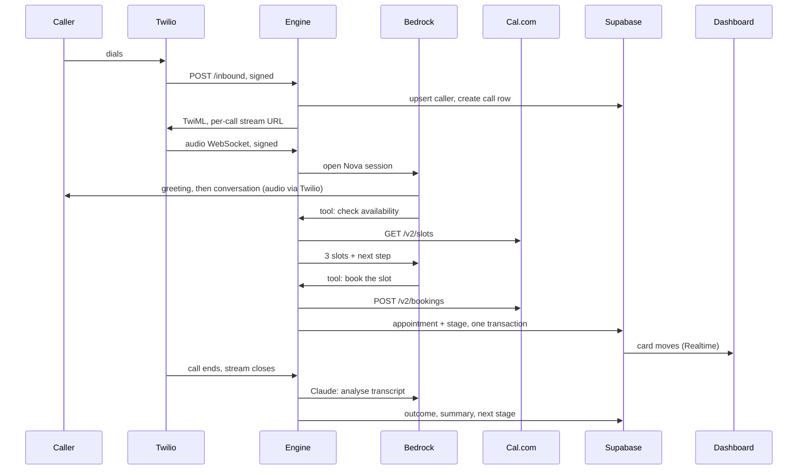
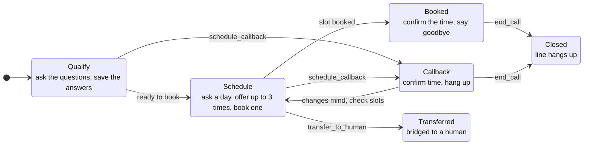
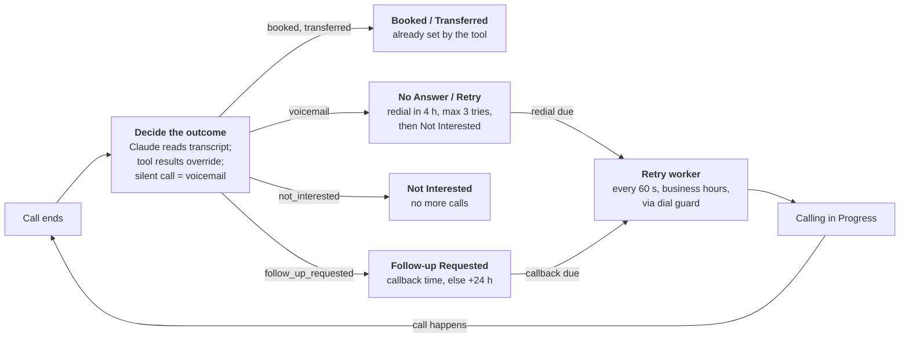

# Voice Agent CRM: Architecture & Flow Design

2026-10-20

One Nova 2.5 Sonic voice session per call answers inbound calls, places speed-to-lead calls, and books Cal.com slots, while a real-time Kanban CRM on local Supabase shows every stage change as it happens. This describes the system as built (spec revision 5, commit a2fdd7b). The full specification is in [CLAUDE.md](../CLAUDE.md); setup steps are in the [README](../README.md).

## At a glance

**One voice engine sits between callers, AI services, and the CRM.**

Phone calls reach the engine through Twilio; browser test calls go straight from the dashboard to the engine over WebRTC. The dashboard reads the CRM directly from Supabase, while every call-side write goes through the engine.

## Components

The system is two apps plus managed AI and telephony services; the voice engine is the only writer for call flows.

| Component | Technology | Responsibility | Code |
| --- | --- | --- | --- |
| Dashboard | Next.js 15, shadcn/ui (Radix), Supabase JS | Kanban pipeline, contact drawer, browser call simulator, Agent Studio; admin sign-in | `apps/web` |
| Voice engine | FastAPI, Pipecat 1.12 | Twilio webhooks and media streams, WebRTC signalling, the call pipeline, tools, post-call analysis, redials, retention | `apps/voice-engine` |
| Call pipeline | Pipecat + `AWSNovaSonicLLMService` | One speech-to-speech session per call: hears the caller, speaks, calls tools | `pipeline/voice_pipeline.py` |
| Conversation flow | Python state machine | Stages, per-stage tool allow-lists, next-step text in every tool result | `pipeline/flow.py`, `pipeline/tools.py` |
| Post-call analysis | Claude Opus 5.5 on Bedrock | Outcome, sentiment, summary, and extracted facts from the transcript | `services/llm.py`, `pipeline/post_call.py` |
| Dial guard | Python | Country allowlist, consent, calling hours, dial and capacity limits before every real dial | `services/dial_guard.py` |
| Retry worker | APScheduler (60 s) | Redials queued, unanswered, and follow-up contacts in business hours | `services/retry_worker.py` |
| Database | Local Supabase: Postgres 17, Auth, Realtime | CRM data, admin-only RLS, live change feed to the dashboard | `supabase/migrations` |
| Speech model | Amazon Nova 2.5 Sonic (`amazon.nova-2-5-sonic`), us-east-1 | Real-time voice: understanding, reasoning, speech, tool calls | AWS CLI credentials |
| Telephony | Twilio Voice + Media Streams (optional) | Real phone calls, 8 kHz mu-law audio over WebSocket, transfers, recordings | `services/telephony.py` |
| Calendar | Cal.com API v2 | Open slots and bookings | `services/calendar.py` |

## Call flows

All three kinds of calls run the same pipeline; they differ only in how the audio arrives and who speaks first.

**Every tool call and database write on a call goes through the voice engine.** An inbound phone call that books a slot, top to bottom:

How the other two start:

- **Outbound speed-to-lead:** a lead from the dashboard or form webhook (or a due redial) passes the dial guard, then Twilio places the call. If an answering machine picks up, the engine hangs up and logs voicemail. If a person answers, Twilio opens the same signed stream; the agent waits for "Hello?" or 1.2 s of silence, then gives its opener.
- **Browser test call:** the dashboard posts a WebRTC offer to the engine (admin only, rate-limited) and the browser's mic connects straight to the pipeline, with no Twilio. Transfers are simulated, and nothing is recorded.

## Conversation flow

Nova Sonic fixes its prompt and tools when the session opens, so the call's steps live in code: every tool stays registered, and each tool result carries the current `stage` and a `next` instruction the model follows.

**Calls move forward only through tools the current step allows.**

From any live step, `transfer_to_human` goes to Transferred, and `end_call` (declined, wrong number, voicemail) goes to Closed. A tool the current step does not allow is rejected, and its result tells the agent what to do instead.

Guards inside the steps: bookings accept only a time offered on this call and a complete email; one upcoming appointment per contact; at most 6 calendar lookups and 2 callbacks per call, callbacks within 60 days. Saved answers, the callback time, and the end reason are ground truth for post-call.

## Post-call and CRM stages

When a call ends, the engine stores the transcript, settles one outcome, and moves the card with fixed rules; the model never picks a stage.

**Code, not the model, decides where a card goes after each call.**

Claude Opus 5.5 on Bedrock returns the outcome, sentiment, a two-sentence summary, and extracted facts as structured output. What the call's tools recorded wins over that reading: a booking, a transfer, a scheduled callback time, or an `end_call` reason. Cards already in Appointment Booked or Transferred to Human never move back. A new lead starts in New Lead and moves to Calling in Progress when it is dialed.

## Data model

Four tables in Postgres hold all CRM state. A contact is one card on the board; every call and booking hangs off it.

| Table | One row per | Key columns | Written by |
| --- | --- | --- | --- |
| `contacts` | Person (unique phone) | `stage` (7-value `pipeline_stage` enum), `retry_count`, `next_follow_up_at`, `consent_at` / `consent_source`, `custom_fields` (jsonb), `deal_value`, `tags` | Lead API, call flow, post-call, dashboard edits |
| `call_logs` | Call (phone or browser) | `direction`, `provider_call_id` (Twilio CallSid or WebRTC id), `transcript`, `summary`, `outcome`, `sentiment`, `extracted_data` (incl. the stage path), `recording_url`, `duration_seconds` | Voice engine only |
| `appointments` | Cal.com booking | `cal_booking_uid`, `scheduled_at`, `status`, `call_log_id` | Booking tool, in one transaction with the contact's stage |
| `agent_config` | Exactly one row | Agent name, company, Nova voice, greetings, qualification questions, objection handlers, Cal.com event type, transfer number, timezone, business hours, `record_calls` + disclosure | Agent Studio |

The seven pipeline stages are the Kanban columns: New Lead, Calling in Progress, No Answer / Retry, Follow-up Requested, Appointment Booked, Transferred to Human, Not Interested. `contacts`, `call_logs`, and `appointments` are in the Realtime publication with full old-row images, so the board can animate stage moves. Migrations: `0001_initial_schema.sql`, `0002_security.sql`, `0003_least_privilege.sql`.

## Security architecture

Every request crosses one of five trust boundaries, and each has its own check; nothing trusts the caller's words, the browser, or Twilio by default.

| Boundary | Who is on the other side | Controls |
| --- | --- | --- |
| Dashboard and API | Signed-in users | Self sign-up off; only `app_metadata.role = admin`, checked in three places: Postgres RLS (`is_admin()` re-checks `auth.users`, so revocation is immediate), the voice-engine guard (30 s role cache), and the Next.js middleware. CSP with `frame-ancestors 'none'`, HSTS in production. Per-IP rate limits. |
| Twilio webhooks and media streams | Twilio (or an attacker posing as it) | `X-Twilio-Signature` on every webhook and on the WebSocket handshake; the stream URL carries the call id, so each call has its own signature; one stream per live call. |
| Outbound dialing | Phone network (toll fraud, harassment) | Dial guard on every dial and transfer: allowed countries (default US/Canada), consent on record, business hours, 3 dials per number per day, 30 per hour, `MAX_CONCURRENT_CALLS`. |
| The caller's words | Anyone who phones in | Tools refuse out-of-order calls; caps on lookups, callbacks, and bookings; caller text is cleaned and fenced in `<caller_data>` before it reaches any prompt; the flow, not the transcript classifier, decides outcomes. |
| Configuration and data | Operators, logs, storage | `APP_ENV=auto` refuses to start in production with default secrets; INFO logging (DEBUG leaks prompts); phone numbers masked; recordings only through an admin proxy; transcripts and recordings purged after `RETENTION_DAYS` (365). |

Open item: the Twilio WebSocket signature check and recording proxy have not yet run against a live Twilio account.

## Deployment and configuration

Locally, everything runs on one machine for $0 in telephony; a deployment adds a public HTTPS URL, Twilio, and a hosted Supabase project.

| Process | Local address | Started with |
| --- | --- | --- |
| Supabase (Postgres, Auth, Realtime, Studio) | 54322 (DB), 54321 (API), 54323 (Studio) | `supabase start` (Docker) |
| Voice engine | 8000 by default (8010 on the current dev machine) | `uv run uvicorn src.main:app` |
| Dashboard | 3000 | `npm run dev` |
| Public tunnel (phone calls only) | your HTTPS URL | `ngrok http 8000` |

Key settings (all in `.env`):

- **AWS:** credentials from the AWS CLI profile, `AWS_REGION=us-east-1`, `NOVA_SONIC_MODEL_ID=amazon.nova-2-5-sonic`, `BEDROCK_CLAUDE_MODEL_ID=anthropic.claude-opus-5-5`.
- **Mode:** `APP_ENV=auto` turns production on when Twilio is enabled or the public or Supabase URL is not local; `TELEPHONY_PROVIDER=webrtc_only` for browser-only use.
- **Limits:** `MAX_CONCURRENT_CALLS=10`, `MAX_DIALS_PER_NUMBER_PER_DAY=3`, `MAX_DIALS_PER_HOUR=30`, `MAX_BOOKINGS_PER_HOUR=20`, `ALLOWED_DIAL_COUNTRY_CODES=["1"]`.
- **Data:** `RETENTION_DAYS=365`, `LOG_LEVEL=INFO`, recording off by default (Agent Studio).

`docker-compose.yml` runs the voice engine and dashboard in containers against the CLI-managed database, with `~/.aws` mounted read-only.
